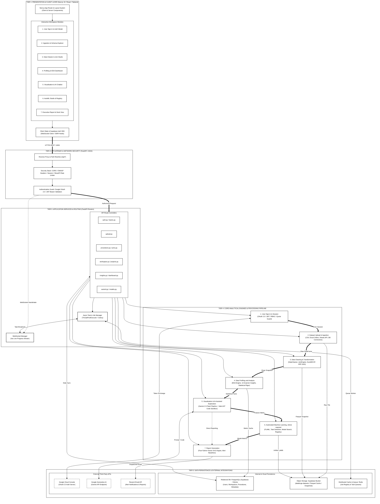
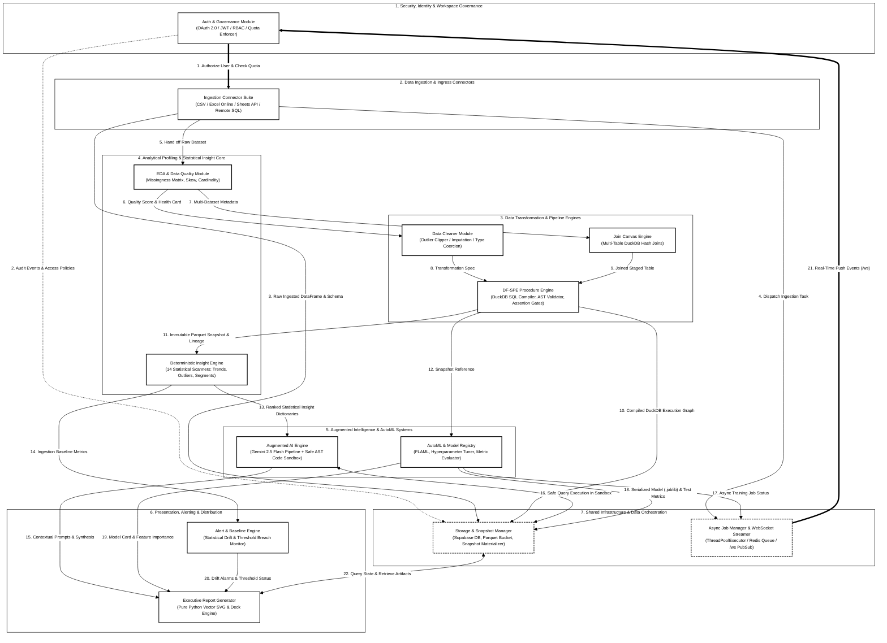

# DataForge v3 — System Architecture & Engineering Diagrams
**Academic & Technical Documentation Series**  
**Document Standard:** ISO/IEC/IEEE 42010 Architecture Description & Structured Analysis (DFD)  
**Target Format:** A4 Portrait Print (Black & White / Monochrome Textbook Aesthetic, Pure White Figures & White Arrow Labels)  

---

## Table of Figures

| Figure | Title | Description | Page Ratio |
| :--- | :--- | :--- | :--- |
| **Figure 3.1** | [System Workflow](#figure-31-system-workflow) | Operational lifecycle across the 7 textbook stages from sign-in to report generation | A4 Portrait |
| **Figure 3.2** | [DataForge System Architecture](#figure-32-dataforge-system-architecture) | Five-tier structural architecture mapping client, gateway, services, pipeline engines, and persistence | A4 Portrait |
| **Figure 3.3** | [Context Diagram (Level 0) DFD](#figure-33-context-diagram-level-0-dfd) | High-level system boundary, external entities, and primary I/O data streams | A4 Portrait |
| **Figure 3.4** | [Detailed Diagram (Level 1) DFD](#figure-34-detailed-diagram-level-1-dfd) | Decomposition into 7 core subprocesses, 6 internal data stores, and entity flows | A4 Portrait |
| **Figure 3.5** | [Functional Module Interaction Diagram](#figure-35-functional-module-interaction-diagram) | Subsystem interface contracts, event streams, and procedural data exchanges | A4 Portrait |

---

## Figure 3.1: System Workflow

### Description
Figure 3.1 delineates the complete execution lifecycle of the DataForge v3 ecosystem across the seven core stages: **User sign-in → Dataset upload → Data cleaning → Data profiling and analysis → Visualisation and AI-assisted exploration → Automated machine learning, where required → Report generation**. Rendered with pure white figures, crisp black borders, and white arrow label backgrounds for pristine textbook printing.

```mermaid
%%{init: {
  'theme': 'base',
  'themeVariables': {
    'primaryColor': '#ffffff',
    'primaryTextColor': '#000000',
    'primaryBorderColor': '#000000',
    'lineColor': '#000000',
    'secondaryColor': '#ffffff',
    'tertiaryColor': '#ffffff',
    'mainBkg': '#ffffff',
    'nodeBorder': '#000000',
    'clusterBkg': '#ffffff',
    'clusterBorder': '#000000',
    'defaultLinkColor': '#000000',
    'titleColor': '#000000',
    'edgeLabelBackground': '#ffffff',
    'fontFamily': 'Helvetica, Arial, sans-serif',
    'fontSize': '11px'
  },
  'themeCSS': '.edgeLabel { background-color: #ffffff !important; color: #000000 !important; border: 1px solid #000000 !important; padding: 2px 4px !important; border-radius: 2px !important; font-size: 10px !important; } .edgeLabel rect { fill: #ffffff !important; stroke: #000000 !important; stroke-width: 0.8px !important; } .cluster rect { fill: #ffffff !important; stroke: #000000 !important; stroke-width: 1.5px !important; } .node rect, .node circle, .node ellipse, .node polygon, .node path { fill: #ffffff !important; stroke: #000000 !important; }'
}}%%

flowchart TD
    classDef process fill:#ffffff,stroke:#000000,stroke-width:1.5px,color:#000000;
    classDef decision fill:#ffffff,stroke:#000000,stroke-width:1.5px,stroke-dasharray: 4 2,color:#000000;
    classDef terminal fill:#ffffff,stroke:#000000,stroke-width:2px,color:#000000;

    START(["● START: User Accesses DataForge"]):::terminal

    subgraph SG1 ["1. User sign-in"]
        A1["Google OAuth 2.0 / JWT Login"]:::process
        A2{"Valid Session & Active Tier?"}:::decision
        A3["Load Workspace & Quotas<br/>(Personal or Organization)"]:::process
        A4["Init Real-Time Socket<br/>(FastAPI /ws Connection)"]:::process
    end

    subgraph SG2 ["2. Dataset upload"]
        B1["Select Source: CSV / Excel /<br/>Google Sheets API / External DB"]:::process
        B2["Streaming Ingestion & Storage<br/>(Supabase Object Store / Local)"]:::process
        B3["Auto-Detect Schema & Delimiter<br/>(Pandas & DuckDB Sniffer)"]:::process
        B4["Generate Ingestion Health Card<br/>(Null %, Types, Memory Footprint)"]:::process
    end

    subgraph SG3 ["3. Data cleaning"]
        C1{"Cleaning Mode?"}:::decision
        C2["DataCleaner Pipeline:<br/>Imputation, Outliers, Coercion"]:::process
        C3["Join Canvas Studio:<br/>Inner/Left/Right/Outer (DuckDB)"]:::process
        C4["DF-SPE Stored Procedure:<br/>Compiled SQL DAG + Assertion Gates"]:::process
        C5["Materialize Snapshot & Lineage<br/>(Why-Provenance Manifest)"]:::process
    end

    subgraph SG4 ["4. Data profiling and analysis"]
        D1["Run 14 Heuristic Scanners<br/>(Trends, Outliers, Correlations, Segments)"]:::process
        D2["Statistical Rigor & Significance<br/>(Z-Score, IQR, Chi-Sq, Pearson)"]:::process
        D3["Baseline Metric Caching & Profile Summary"]:::process
    end

    subgraph SG5 ["5. Visualisation and AI-assisted exploration"]
        E1["Interactive Dashboard & Chart Plots"]:::process
        E2["Gemini 2.5 Flash Pipeline:<br/>Automated Executive Narrative"]:::process
        E3["Conversational Analyst Chatbot:<br/>NL Query → Pandas AST → Sandbox"]:::process
    end

    subgraph SG6 ["6. Automated machine learning, where required"]
        F1{"Train Model?"}:::decision
        F2["Auto Task Detection & Imbalance Check<br/>(Classification vs Regression)"]:::process
        F3["FLAML & Scikit-Learn Search<br/>(Isolated Worker Execution)"]:::process
        F4["Evaluate Metrics & Feature Importance<br/>(ROC-AUC, F1, RMSE, R²)"]:::process
        F5["Register Artifact (.joblib)<br/>in DataForge Model Registry"]:::process
    end

    subgraph SG7 ["7. Report generation"]
        G1["Generate Executive PDF Report<br/>(Pure Python Vector SVG Charts)"]:::process
        G2["Save Metric Baseline & Rules<br/>(Alert Engine Thresholds)"]:::process
        G3["Export Parquet / Team Share<br/>(RBAC Governance & Webhooks)"]:::process
    end

    END_NODE(["■ END: Insights Delivered & Deployed"]):::terminal

    START --> A1
    A1 --> A2
    A2 -- "No (Invalid)" --> A1
    A2 -- "Yes (Authorized)" --> A3
    A3 --> A4
    A4 ==>|"Authenticated"| B1

    B1 --> B2
    B2 --> B3
    B3 --> B4
    B4 ==>|"Raw Schema"| C1

    C1 -- "Cleaning Rules" --> C2
    C1 -- "Multi-Table Join" --> C3
    C1 -- "Stored Procedure" --> C4

    C2 --> C5
    C3 --> C5
    C4 --> C5

    C5 ==>|"Cleaned Snapshot"| D1
    D1 --> D2
    D2 --> D3

    D3 ==>|"Statistical Facts"| E1
    E1 --> E2
    E2 --> E3

    E3 ==>|"Prepared Data"| F1
    F1 -- "Yes (AutoML)" --> F2
    F2 --> F3
    F3 --> F4
    F4 --> F5
    F5 ==>|"Model Metrics"| G1
    F1 -- "Skip (Exploration Only)" --> G1

    G1 --> G2
    G2 --> G3
    G3 --> END_NODE
```

*Figure 3.1: DataForge End-to-End System Workflow.*

---

## Figure 3.2: DataForge System Architecture

### Description
Figure 3.2 illustrates the five-tier structural engineering architecture of DataForge v3. All elements are formatted in pure white with high-contrast black strokes and white-background edge labels, highlighting the integrated core analytical processing pipeline (User Sign-In, Dataset Upload, Data Cleaning, Data Profiling, Visualisation & AI Exploration, AutoML, and Report Generation) supported by Client, Gateway, Routing, and Persistence tiers.

*Figure 3.2: Multi-Tiered System Architecture of DataForge v3.*

---

## Figure 3.3: Context Diagram (level 0) DFD

### Description
Figure 3.3 presents the formal Level 0 Data Flow Diagram (Context Diagram) under standard structured analysis notation, rendered with pure white entities and white arrow label backgrounds.

```mermaid
%%{init: {
  'theme': 'base',
  'themeVariables': {
    'primaryColor': '#ffffff',
    'primaryTextColor': '#000000',
    'primaryBorderColor': '#000000',
    'lineColor': '#000000',
    'secondaryColor': '#ffffff',
    'tertiaryColor': '#ffffff',
    'mainBkg': '#ffffff',
    'nodeBorder': '#000000',
    'clusterBkg': '#ffffff',
    'clusterBorder': '#000000',
    'defaultLinkColor': '#000000',
    'titleColor': '#000000',
    'edgeLabelBackground': '#ffffff',
    'fontFamily': 'Helvetica, Arial, sans-serif',
    'fontSize': '11px'
  },
  'themeCSS': '.edgeLabel { background-color: #ffffff !important; color: #000000 !important; border: 1px solid #000000 !important; padding: 2px 4px !important; border-radius: 2px !important; font-size: 10px !important; } .edgeLabel rect { fill: #ffffff !important; stroke: #000000 !important; stroke-width: 0.8px !important; } .cluster rect { fill: #ffffff !important; stroke: #000000 !important; stroke-width: 1.5px !important; } .node rect, .node circle, .node ellipse, .node polygon, .node path { fill: #ffffff !important; stroke: #000000 !important; }'
}}%%

flowchart TD
    classDef entity fill:#ffffff,stroke:#000000,stroke-width:2px,color:#000000;
    classDef systemProcess fill:#ffffff,stroke:#000000,stroke-width:2.5px,color:#000000;

    %% Central Process
    P0(["0.0<br/>DATAFORGE SYSTEM<br/>(Automated Data Engineering, Profiling,<br/>AI Analytics & AutoML Platform)"]):::systemProcess

    %% Terminators
    E_USER["EXTERNAL ENTITY: E1<br/>Data Analyst / End User<br/>(Browser Client)"]:::entity
    E_SOURCES["EXTERNAL ENTITY: E2<br/>External Data Providers<br/>(Google Sheets / External DBs)"]:::entity
    E_AUTH["EXTERNAL ENTITY: E3<br/>Google OAuth 2.0<br/>(Identity Provider)"]:::entity
    E_AI["EXTERNAL ENTITY: E4<br/>Google Gemini AI<br/>(Generative Language Model)"]:::entity
    E_CLOUD["EXTERNAL ENTITY: E5<br/>Supabase Cloud Platform<br/>(PostgreSQL & Object Bucket)"]:::entity
    E_NOTIF["EXTERNAL ENTITY: E6<br/>Communication Services<br/>(Resend Email & Webhooks)"]:::entity

    %% Flows
    E_USER ==>|"1. Upload Files (CSV/Excel), Clean Rules,<br/>NL Queries, AutoML Targets"| P0
    P0 ==>|"2. Real-Time Ingestion Preview, Diff Cards,<br/>AI Narratives, Model Metrics & PDF Reports"| E_USER

    E_SOURCES -->|"3. Stream Remote Tabular Datasets & Sheet Cells"| P0
    P0 -.->|"4. API Credentials, Fetch Tokens & SQL Selects"| E_SOURCES

    E_AUTH -->|"5. User Identity Claims (sub, email, avatar)"| P0
    P0 -.->|"6. Authorization Code & Redirection Request"| E_AUTH

    P0 -->|"7. Prompt Context: Schema, Stats & NL Query"| E_AI
    E_AI -->|"8. Narrative Summaries & Pandas Analysis AST"| P0

    P0 -->|"9. Store Parquet Snapshots, DB Rows, Models & Logs"| E_CLOUD
    E_CLOUD -->|"10. Retrieve Workspaces, Lineage & Quotas"| P0

    P0 -->|"11. Metric Drift Alerts & Scheduled Reports"| E_NOTIF
    E_NOTIF -.->|"12. Delivery Acknowledgments"| P0
```

*Figure 3.3: Level 0 Context Data Flow Diagram.*

---

## Figure 3.4: Detailed Diagram (level 1) DFD

### Description
Figure 3.4 decomposes process `0.0` into seven discrete Level 1 subprocesses and six internal data stores, formatted with pure white figures and white arrow label backgrounds.

```mermaid
%%{init: {
  'theme': 'base',
  'themeVariables': {
    'primaryColor': '#ffffff',
    'primaryTextColor': '#000000',
    'primaryBorderColor': '#000000',
    'lineColor': '#000000',
    'secondaryColor': '#ffffff',
    'tertiaryColor': '#ffffff',
    'mainBkg': '#ffffff',
    'nodeBorder': '#000000',
    'clusterBkg': '#ffffff',
    'clusterBorder': '#000000',
    'defaultLinkColor': '#000000',
    'titleColor': '#000000',
    'edgeLabelBackground': '#ffffff',
    'fontFamily': 'Helvetica, Arial, sans-serif',
    'fontSize': '10px'
  },
  'themeCSS': '.edgeLabel { background-color: #ffffff !important; color: #000000 !important; border: 1px solid #000000 !important; padding: 2px 4px !important; border-radius: 2px !important; font-size: 10px !important; } .edgeLabel rect { fill: #ffffff !important; stroke: #000000 !important; stroke-width: 0.8px !important; } .cluster rect { fill: #ffffff !important; stroke: #000000 !important; stroke-width: 1.5px !important; } .node rect, .node circle, .node ellipse, .node polygon, .node path { fill: #ffffff !important; stroke: #000000 !important; }'
}}%%

flowchart TD
    classDef entity fill:#ffffff,stroke:#000000,stroke-width:2px,color:#000000;
    classDef process fill:#ffffff,stroke:#000000,stroke-width:1.5px,color:#000000;
    classDef store fill:#ffffff,stroke:#000000,stroke-width:1.5px,stroke-dasharray: 6 2,color:#000000;

    %% External Entities
    E1["EXTERNAL ENTITY: E1<br/>Data Analyst / User"]:::entity
    E2["EXTERNAL ENTITY: E2<br/>External Sources (Sheets/DB)"]:::entity
    E3["EXTERNAL ENTITY: E3<br/>Google OAuth 2.0"]:::entity
    E4["EXTERNAL ENTITY: E4<br/>Google Gemini 2.5 API"]:::entity
    E5["EXTERNAL ENTITY: E5<br/>Supabase Bucket / PostgreSQL"]:::entity
    E6["EXTERNAL ENTITY: E6<br/>Resend Email & Webhooks"]:::entity

    %% Internal Data Stores
    D1[("D1 | Users, Workspaces & Tier Quotas")]:::store
    D2[("D2 | Raw Uploads & Ingested Tables")]:::store
    D3[("D3 | Cleaned Parquet Snapshots & Lineage")]:::store
    D4[("D4 | Analytical Baselines & Insight Cache")]:::store
    D5[("D5 | Model Registry & Weights (.joblib)")]:::store
    D6[("D6 | Audit Logs & Alert Schedules")]:::store

    %% Subprocesses (Level 1)
    P1(["1.0<br/>User Sign-In &<br/>Session Auth"]):::process
    P2(["2.0<br/>Dataset Upload,<br/>Ingest & Validate"]):::process
    P3(["3.0<br/>Data Cleaning,<br/>Joins & Procedures"]):::process
    P4(["4.0<br/>Data Profiling &<br/>Analysis Engine"]):::process
    P5(["5.0<br/>Visualisation &<br/>AI Exploration"]):::process
    P6(["6.0<br/>Automated ML<br/>(where required)"]):::process
    P7(["7.0<br/>Report Generation<br/>& Baseline Alerts"]):::process

    %% Flows: 1.0 Auth
    E1 -->|"OAuth Login Request"| P1
    E3 -->|"OAuth Claims / Token"| P1
    P1 -->|"Write / Update User Record"| D1
    D1 -->|"Read Roles & Quotas"| P1
    P1 -->|"JWT Session Cookie & UI Context"| E1

    %% Flows: 2.0 Ingest
    E1 -->|"Upload Local CSV / Excel"| P2
    E2 -->|"Stream Sheet Cells / SQL Rows"| P2
    P2 -->|"Stage Raw Data Parquet"| D2
    D2 -->|"Read Raw Table"| P2
    P2 -->|"Real-Time Profiling & Schema Health Card"| E1
    P2 -->|"Sync Cloud Mirror"| E5

    %% Flows: 3.0 Transform
    E1 -->|"Cleaning Specs / Join Keys / Procedure DAG"| P3
    D2 -->|"Stream Raw Data"| P3
    P3 -->|"Persist Cleaned Snapshot & Lineage Manifest"| D3
    P3 -->|"Interactive Transformation Diff Preview"| E1
    P3 -->|"Persist Snapshot Artifacts"| E5

    %% Flows: 4.0 Insights
    D3 -->|"Read Cleaned Snapshot"| P4
    P4 -->|"Store Ranked Insight Objects & Baselines"| D4
    P4 -->|"Statistical Visualizations & Heuristic Cards"| E1

    %% Flows: 5.0 AI & Query
    E1 -->|"Natural Language Business Query"| P5
    D3 -->|"Schema & Sample Tuples"| P5
    D4 -->|"Synthesized Statistical Facts"| P5
    P5 -->|"Prompt Envelopes (Schema + Context)"| E4
    E4 -->|"Narrative Explanations & Pandas Code AST"| P5
    P5 -->|"Dynamic Answers & Sandboxed Plotly Charts"| E1

    %% Flows: 6.0 AutoML
    E1 -->|"Target Column & Metric Goal"| P6
    D3 -->|"Train/Test Encoded Matrices"| P6
    P6 -->|"Save Serialized Pipeline & Performance Metrics"| D5
    P6 -->|"Save Model Artifacts"| E5
    P6 -->|"Leaderboard, Confusion Matrix & Predictions"| E1

    %% Flows: 7.0 Reports & Alerts
    D4 -->|"Insight Summaries & Baseline Values"| P7
    D6 -->|"Schedule Rules & Webhook URLs"| P7
    P7 -->|"Downloadable PDF / SVG Presentation Deck"| E1
    P7 -->|"Send Breach Notifications & Summary Decks"| E6
    P1 -.->|"Log User Activity"| D6
    P3 -.->|"Log Audit Event"| D6
```

*Figure 3.4: Level 1 Detailed Data Flow Diagram.*

---

## Figure 3.5: Functional Module Interaction Diagram

### Description
Figure 3.5 formalizes the inter-module contracts, asynchronous event dependencies, and data coupling across the core Python packages, rendered in pure white figures with white arrow label backgrounds.

*Figure 3.5: Functional Module Interaction and Contract Flow Diagram.*
