# Figure 3.1: System Workflow
**DataForge v3 System Architecture Series**  
**Document Standard:** Software Operational Process Model  
**Page Budget:** 1 Page (A4 Portrait, Black & White / Grayscale Print-Ready)  

---

## 1. Architectural Narrative
Figure 3.1 illustrates the complete operational lifecycle across a DataForge v3 session. In direct alignment with the system's operational specification, the process unfolds sequentially across seven core stages:

1. **User sign-in**: Authentication via Google OAuth 2.0 or local development JWT verification, establishing user permissions and loading tenant workspace quotas.
2. **Dataset upload**: Streaming multi-source ingestion (CSV, Excel Online, Google Sheets API, or remote SQL databases) with automatic delimiter sniffing and initial schema inference.
3. **Data cleaning**: Interactive row-level transformations via `DataCleaner`, multi-table relational joins via `JoinCanvas`, or the hardened DuckDB Stored Procedure Execution engine (`DF-SPE`) with AST formula validation, producing immutable Parquet snapshots with Why-Provenance manifests.
4. **Data profiling and analysis**: 14-scanner deterministic statistical scans assessing missingness, distributions, anomalies, trends, correlations, and segments with mathematical rigor (Z-scores, IQR, Chi-Square).
5. **Visualisation and AI-assisted exploration**: Dynamic chart generation and generative narrative synthesis via Google Gemini 2.5 Flash, paired with a conversational analyst chatbot executing Python analysis in an isolated AST sandbox.
6. **Automated machine learning, where required**: FLAML and Scikit-Learn pipeline search with automated task detection (classification vs. regression) and serialized artifact logging in the Model Registry.
7. **Report generation**: Export of publication-ready PDF presentation decks featuring pure Python vector SVG graphics, along with statistical baseline drift monitoring in the Alert Engine.

---

## 2. Mermaid Diagram

```mermaid
%%{init: {
  'theme': 'base',
  'themeVariables': {
    'primaryColor': '#ffffff',
    'primaryTextColor': '#000000',
    'primaryBorderColor': '#000000',
    'lineColor': '#000000',
    'secondaryColor': '#ffffff',
    'tertiaryColor': '#ffffff',
    'mainBkg': '#ffffff',
    'nodeBorder': '#000000',
    'clusterBkg': '#ffffff',
    'clusterBorder': '#000000',
    'defaultLinkColor': '#000000',
    'titleColor': '#000000',
    'edgeLabelBackground': '#ffffff',
    'fontFamily': 'Helvetica, Arial, sans-serif',
    'fontSize': '11px'
  },
  'themeCSS': '.edgeLabel { background-color: #ffffff !important; color: #000000 !important; border: 1px solid #000000 !important; padding: 2px 4px !important; border-radius: 2px !important; font-size: 10px !important; } .edgeLabel rect { fill: #ffffff !important; stroke: #000000 !important; stroke-width: 0.8px !important; } .cluster rect { fill: #ffffff !important; stroke: #000000 !important; stroke-width: 1.5px !important; } .node rect, .node circle, .node ellipse, .node polygon, .node path { fill: #ffffff !important; stroke: #000000 !important; }'
}}%%

flowchart TD
    classDef process fill:#ffffff,stroke:#000000,stroke-width:1.5px,color:#000000;
    classDef decision fill:#ffffff,stroke:#000000,stroke-width:1.5px,stroke-dasharray: 4 2,color:#000000;
    classDef terminal fill:#ffffff,stroke:#000000,stroke-width:2px,color:#000000;

    START(["● START: User Accesses DataForge"]):::terminal

    subgraph SG1 ["1. User sign-in"]
        A1["Google OAuth 2.0 / JWT Login"]:::process
        A2{"Valid Session & Active Tier?"}:::decision
        A3["Load Workspace & Quotas<br/>(Personal or Organization)"]:::process
        A4["Init Real-Time Socket<br/>(FastAPI /ws Connection)"]:::process
    end

    subgraph SG2 ["2. Dataset upload"]
        B1["Select Source: CSV / Excel /<br/>Google Sheets API / External DB"]:::process
        B2["Streaming Ingestion & Storage<br/>(Supabase Object Store / Local)"]:::process
        B3["Auto-Detect Schema & Delimiter<br/>(Pandas & DuckDB Sniffer)"]:::process
        B4["Generate Ingestion Health Card<br/>(Null %, Types, Memory Footprint)"]:::process
    end

    subgraph SG3 ["3. Data cleaning"]
        C1{"Cleaning Mode?"}:::decision
        C2["DataCleaner Pipeline:<br/>Imputation, Outliers, Coercion"]:::process
        C3["Join Canvas Studio:<br/>Inner/Left/Right/Outer (DuckDB)"]:::process
        C4["DF-SPE Stored Procedure:<br/>Compiled SQL DAG + Assertion Gates"]:::process
        C5["Materialize Snapshot & Lineage<br/>(Why-Provenance Manifest)"]:::process
    end

    subgraph SG4 ["4. Data profiling and analysis"]
        D1["Run 14 Heuristic Scanners<br/>(Trends, Outliers, Correlations, Segments)"]:::process
        D2["Statistical Rigor & Significance<br/>(Z-Score, IQR, Chi-Sq, Pearson)"]:::process
        D3["Baseline Metric Caching & Profile Summary"]:::process
    end

    subgraph SG5 ["5. Visualisation and AI-assisted exploration"]
        E1["Interactive Dashboard & Chart Plots"]:::process
        E2["Gemini 2.5 Flash Pipeline:<br/>Automated Executive Narrative"]:::process
        E3["Conversational Analyst Chatbot:<br/>NL Query → Pandas AST → Sandbox"]:::process
    end

    subgraph SG6 ["6. Automated machine learning, where required"]
        F1{"Train Model?"}:::decision
        F2["Auto Task Detection & Imbalance Check<br/>(Classification vs Regression)"]:::process
        F3["FLAML & Scikit-Learn Search<br/>(Isolated Worker Execution)"]:::process
        F4["Evaluate Metrics & Feature Importance<br/>(ROC-AUC, F1, RMSE, R²)"]:::process
        F5["Register Artifact (.joblib)<br/>in DataForge Model Registry"]:::process
    end

    subgraph SG7 ["7. Report generation"]
        G1["Generate Executive PDF Report<br/>(Pure Python Vector SVG Charts)"]:::process
        G2["Save Metric Baseline & Rules<br/>(Alert Engine Thresholds)"]:::process
        G3["Export Parquet / Team Share<br/>(RBAC Governance & Webhooks)"]:::process
    end

    END_NODE(["■ END: Insights Delivered & Deployed"]):::terminal

    START --> A1
    A1 --> A2
    A2 -- "No (Invalid)" --> A1
    A2 -- "Yes (Authorized)" --> A3
    A3 --> A4
    A4 ==>|"Authenticated"| B1

    B1 --> B2
    B2 --> B3
    B3 --> B4
    B4 ==>|"Raw Schema"| C1

    C1 -- "Cleaning Rules" --> C2
    C1 -- "Multi-Table Join" --> C3
    C1 -- "Stored Procedure" --> C4

    C2 --> C5
    C3 --> C5
    C4 --> C5

    C5 ==>|"Cleaned Snapshot"| D1
    D1 --> D2
    D2 --> D3

    D3 ==>|"Statistical Facts"| E1
    E1 --> E2
    E2 --> E3

    E3 ==>|"Prepared Data"| F1
    F1 -- "Yes (AutoML)" --> F2
    F2 --> F3
    F3 --> F4
    F4 --> F5
    F5 ==>|"Model Metrics"| G1
    F1 -- "Skip (Exploration Only)" --> G1

    G1 --> G2
    G2 --> G3
    G3 --> END_NODE
```

---

## 3. Key Process Specifications

| Step ID | Subsystem / Module | Input | Output / State Transition |
| :--- | :--- | :--- | :--- |
| **1.0** | `dataforge.api.auth` | Client OAuth token / Cookie | Authenticated user session; tenant quota verification |
| **2.0** | `dataforge.csv_connector`, `upload` | Raw binary / remote stream | Parquet file in storage; schema metadata dictionary |
| **3.0** | `dataforge.procedure_engine`, `join_engine` | Transformation rules / DAG | Immutable snapshot; Why-Provenance manifest |
| **4.0** | `dataforge.insight_engine` | Cleaned Snapshot DataFrame | Ranked heuristic metrics; statistical baselines |
| **5.0** | `dataforge.gemini_pipeline`, `sandbox` | Schema & NL query | Dynamic Plotly charts; executive narrative report |
| **6.0** | `dataforge.automl_trainer` | Target column & loss metric | Serialized model pipeline (`.joblib`); metric cards |
| **7.0** | `dataforge.report_generator`, `alert_engine` | Profile metrics & baseline | Exportable presentation PDF deck; drift alarms |
