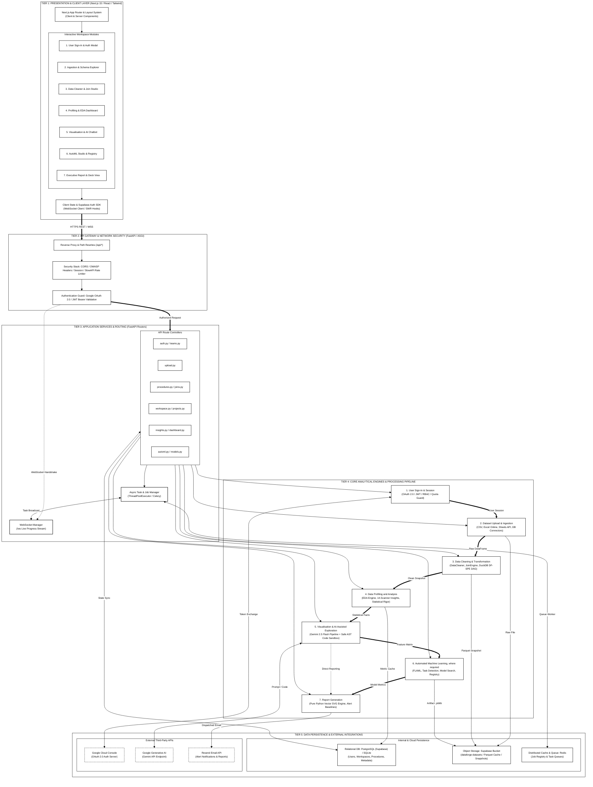

# Figure 3.2: DataForge System Architecture
**DataForge v3 System Architecture Series**  
**Document Standard:** Multi-Tiered System Architecture (IEEE 1471 / ISO 42010)  
**Page Budget:** 1 Page (A4 Portrait, Black & White / Grayscale Print-Ready)  

---

## 1. Architectural Narrative
Figure 3.2 depicts the five-tier structural engineering architecture of DataForge v3. The system is decoupled into discrete, scalable, and secure tiers with pure white figures and high-contrast monochrome textbook formatting:

1. **Tier 1: Presentation & Client Layer (Next.js 15 / React / Tailwind)**: Encapsulates the App Router, server/client component boundaries, and individual workspace view modules matching the end-to-end user journey: User Sign-In, Ingestion Explorer, Data Cleaner & Join Studio, Profiling & EDA Dashboard, Visualisation & AI Chatbot, AutoML Studio, and Executive Reports.
2. **Tier 2: API Gateway & Network Security (FastAPI / ASGI)**: Manages reverse proxy path rewrites (`/api/*`), CORS policies, OWASP defensive security headers, cookie session encryption, and `SlowAPI` token-bucket rate limiting.
3. **Tier 3: Application Services & Routing**: Routes HTTP/WebSocket traffic through modular controllers (`upload`, `workspace`, `procedures`, `joins`, `insights`, `automl`, `dashboard`). Employs an asynchronous `JobManager` backed by a `ThreadPoolExecutor` and Celery/Redis for non-blocking task processing.
4. **Tier 4: Core Analytical Engines & Processing Pipeline**: Houses the core pipeline stages: User Sign-In & Session, Dataset Upload & Ingestion, Data Cleaning & Transformation, Data Profiling and Analysis, Visualisation and AI-Assisted Exploration, Automated Machine Learning (where required), and Report Generation.
5. **Tier 5: Data Persistence & External Integrations**: Combines relational metadata storage (PostgreSQL on Supabase or local SQLite), object storage (`dataforge-datasets` bucket for Parquet caches and snapshots), Redis distributed message broker, and third-party APIs (Google Cloud OAuth 2.0, Google Generative AI, Resend Email).

---

## 2. Mermaid Diagram

---

## 3. Structural Layer Specifications

| Tier | Component Group | Technology Stack | Security / Protocol |
| :--- | :--- | :--- | :--- |
| **Tier 1: Client** | Workspace UI & State | Next.js 15, React 19, Tailwind CSS | HTTPS, WSS, HttpOnly Cookies |
| **Tier 2: Gateway** | Routing & Ingress Defense | FastAPI, Uvicorn, SlowAPI | JWT Bearer, CORS Origin Validation |
| **Tier 3: Services** | Controllers & Job Dispatch | FastAPI Routers, ThreadPoolExecutor | Celery Worker Isolation, Task Registry |
| **Tier 4: Pipeline Core** | Analytical Compute Pipeline | DuckDB, Pandas, NumPy, FLAML, Gemini | AST Sanitization, Restricted Sandbox |
| **Tier 5: Storage** | Data & Cloud Endpoints | PostgreSQL, Supabase Storage, Redis | Row Level Security (RLS), AES Encryption |
