# Figure 3.3: Context Diagram (level 0) DFD
**DataForge v3 System Architecture Series**  
**Document Standard:** Structured Analysis Data Flow Diagram (Yourdon / Gane-Sarson)  
**Page Budget:** 1 Page (A4 Portrait, Black & White / Grayscale Print-Ready)  

---

## 1. Architectural Narrative
Figure 3.3 defines the system boundary for DataForge v3 via a Level 0 Context Data Flow Diagram (DFD). In accordance with structured systems analysis standards, the entire software platform is encapsulated as a single central transformation process: `0.0 DATAFORGE SYSTEM`. 

The central system interfaces directly with six external entities (terminators):
- **E1: Data Analyst / End User**: Interacts via web browser, submitting raw files, cleaning rules, natural language queries, and model training targets, while receiving interactive diff cards, profiling reports, dynamic charts, model metrics, and publication-ready decks.
- **E2: External Data Providers (Google Sheets / External DBs)**: Streams remote tabular data and receives API authentication tokens and query definitions.
- **E3: Google OAuth 2.0 (Identity Provider)**: Handles user authentication, exchanging authorization codes for verified identity claims (sub, email, avatar).
- **E4: Google Gemini AI (Generative Language Model)**: Ingests structured prompt contexts (statistical summaries, schema profiles) and generates executive narratives and validated Pandas analysis code.
- **E5: Supabase Cloud Platform (PostgreSQL & Object Bucket)**: Acts as the primary persistence layer, receiving Parquet snapshots, database records, and model artifacts while providing stored datasets, memberships, and quota metadata.
- **E6: Communication Services (Resend Email & Webhooks)**: Ingests alert payloads, metric drift warnings, and scheduled executive reports for external notification delivery.

---

## 2. Mermaid Diagram

```mermaid
%%{init: {
  'theme': 'base',
  'themeVariables': {
    'primaryColor': '#ffffff',
    'primaryTextColor': '#000000',
    'primaryBorderColor': '#000000',
    'lineColor': '#000000',
    'secondaryColor': '#f5f5f5',
    'tertiaryColor': '#ffffff',
    'edgeLabelBackground': '#ffffff',
    'fontFamily': 'Helvetica, Arial, sans-serif',
    'fontSize': '11px'
  }
}}%%

flowchart TD
    classDef entity fill:#ffffff,stroke:#000000,stroke-width:2px,color:#000000;
    classDef systemProcess fill:#f5f5f5,stroke:#000000,stroke-width:2.5px,color:#000000;

    %% Central Process
    P0(["0.0<br/>DATAFORGE SYSTEM<br/>(Automated Data Engineering, Profiling,<br/>AI Analytics & AutoML Platform)"]):::systemProcess

    %% Terminators
    E_USER["EXTERNAL ENTITY: E1<br/>Data Analyst / End User<br/>(Browser Client)"]:::entity
    E_SOURCES["EXTERNAL ENTITY: E2<br/>External Data Providers<br/>(Google Sheets / External DBs)"]:::entity
    E_AUTH["EXTERNAL ENTITY: E3<br/>Google OAuth 2.0<br/>(Identity Provider)"]:::entity
    E_AI["EXTERNAL ENTITY: E4<br/>Google Gemini AI<br/>(Generative Language Model)"]:::entity
    E_CLOUD["EXTERNAL ENTITY: E5<br/>Supabase Cloud Platform<br/>(PostgreSQL & Object Bucket)"]:::entity
    E_NOTIF["EXTERNAL ENTITY: E6<br/>Communication Services<br/>(Resend Email & Webhooks)"]:::entity

    %% Flows
    E_USER ==>|"1. Upload Files (CSV/Excel), Clean Rules,<br/>NL Queries, AutoML Targets"| P0
    P0 ==>|"2. Real-Time Ingestion Preview, Diff Cards,<br/>AI Narratives, Model Metrics & PDF Reports"| E_USER

    E_SOURCES -->|"3. Stream Remote Tabular Datasets & Sheet Cells"| P0
    P0 -.->|"4. API Credentials, Fetch Tokens & SQL Selects"| E_SOURCES

    E_AUTH -->|"5. User Identity Claims (sub, email, avatar)"| P0
    P0 -.->|"6. Authorization Code & Redirection Request"| E_AUTH

    P0 -->|"7. Prompt Context: Schema, Stats & NL Query"| E_AI
    E_AI -->|"8. Narrative Summaries & Pandas Analysis AST"| P0

    P0 -->|"9. Store Parquet Snapshots, DB Rows, Models & Logs"| E_CLOUD
    E_CLOUD -->|"10. Retrieve Workspaces, Lineage & Quotas"| P0

    P0 -->|"11. Metric Drift Alerts & Scheduled Reports"| E_NOTIF
    E_NOTIF -.->|"12. Delivery Acknowledgments"| P0
```

---

## 3. Boundary Data Flow Dictionary

| Flow ID | Source | Target | Data Description / Payload Elements |
| :---: | :--- | :--- | :--- |
| **1** | User (E1) | System (P0) | Multipart CSV/Excel uploads, cleaning specs, natural language queries, AutoML target |
| **2** | System (P0) | User (E1) | Health scorecards, transformation previews, dynamic charts, model metrics, PDF decks |
| **3** | External Sources (E2) | System (P0) | Google Sheets cell data, external SQL query row results, connector schemas |
| **4** | System (P0) | External Sources (E2) | OAuth refresh tokens, connector credentials, SQL extraction queries |
| **5** | Google OAuth (E3) | System (P0) | JWT ID tokens, OAuth sub, verified email, user display name, avatar URL |
| **6** | System (P0) | Google OAuth (E3) | OAuth redirect URI, client ID, requested authentication scopes |
| **7** | System (P0) | Gemini AI (E4) | Formatted prompt envelope: schema, statistical distribution, user question |
| **8** | Gemini AI (E4) | System (P0) | Structured executive markdown text, generated Python Pandas AST code blocks |
| **9** | System (P0) | Supabase (E5) | Cleaned Parquet snapshots, why-provenance manifests, procedure definitions, audit logs |
| **10** | Supabase (E5) | System (P0) | User profiles, workspace records, procedure versions, dataset storage paths |
| **11** | System (P0) | Notifications (E6) | Transactional email HTML, metric threshold breach alarms, scheduled PDF decks |
| **12** | Notifications (E6) | System (P0) | SMTP / HTTP 200 delivery receipt, message dispatch ID |
