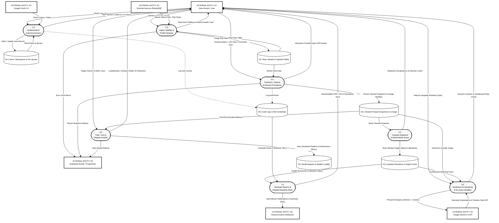

# Figure 3.4: Detailed Diagram (level 1) DFD
**DataForge v3 System Architecture Series**  
**Document Standard:** Decomposed Data Flow Diagram (DFD Level 1)  
**Page Budget:** 1 Page (A4 Portrait, Black & White / Grayscale Print-Ready)  

---

## 1. Architectural Narrative
Figure 3.4 provides the Level 1 functional decomposition of process `0.0 DataForge System`. The system boundary is expanded into seven dedicated subprocesses and six internal data stores, mapping data flow paths, transformations, and state persistence:

- **Process 1.0 (Authenticate & Authorize Session)**: Interfaces with Google OAuth and data store `D1` to register users, enforce role-based access control (Admin, Data Engineer, Analyst, Viewer), and verify subscription quotas.
- **Process 2.0 (Ingest, Validate & Profile Datasets)**: Ingests raw data streams from users and external providers, stages the tables in `D2`, performs automated schema sniffing, and emits data health scorecards.
- **Process 3.0 (Transform, Cleanse & Execute Procedures)**: Drives the DuckDB Stored Procedure Execution engine (`DF-SPE`) and `DataCleaner`, executing AST-validated DAGs and multi-table joins, materializing immutable snapshots and lineage manifests into `D3`.
- **Process 4.0 (Compute Statistical & Deterministic Scans)**: Executes 14 heuristic scans across the cleaned snapshots in `D3`, writing ranked insight dictionaries and baseline metrics into `D4`.
- **Process 5.0 (Synthesize AI Narratives & NL Query Sandbox)**: Enriches statistical baselines from `D4` with Google Gemini 2.5 generative synthesis, and executes natural language queries by generating and executing sandboxed Pandas code.
- **Process 6.0 (Train, Tune & Register AutoML)**: Ingests training matrices from `D3`, runs FLAML model search and task detection, and registers trained pipelines (`.joblib`) and evaluation metrics in `D5`.
- **Process 7.0 (Generate Reports & Dispatch Baseline Alerts)**: Pulls insight metrics from `D4` and alert rules from `D6`, generating pure Python SVG executive presentation decks and sending threshold breach notifications via `E6`.

---

## 2. Mermaid Diagram

---

## 3. Data Store Schema & Role Mapping

| Store ID | Logical Name | Physical Storage | Principal Schema / Contents |
| :---: | :--- | :--- | :--- |
| **D1** | Users & Quotas | PostgreSQL / SQLite | `users`, `organizations`, `memberships`, `subscriptions` |
| **D2** | Raw Uploads | Local Parquet / Supabase | `uploads`, raw CSV/Excel chunks, schema discovery JSON |
| **D3** | Clean Snapshots | Parquet / Supabase Bucket | Immutable snapshots, `procedures`, `lineage_manifest_json` |
| **D4** | Insight Cache | Relational DB / Memory | Statistical baselines, metric definitions, correlation matrices |
| **D5** | Model Registry | File Storage / Supabase | Trained `.joblib` estimators, feature importance, test metrics |
| **D6** | Audit & Alerts | PostgreSQL / SQLite | `audit_events`, `report_schedules`, webhook targets |
