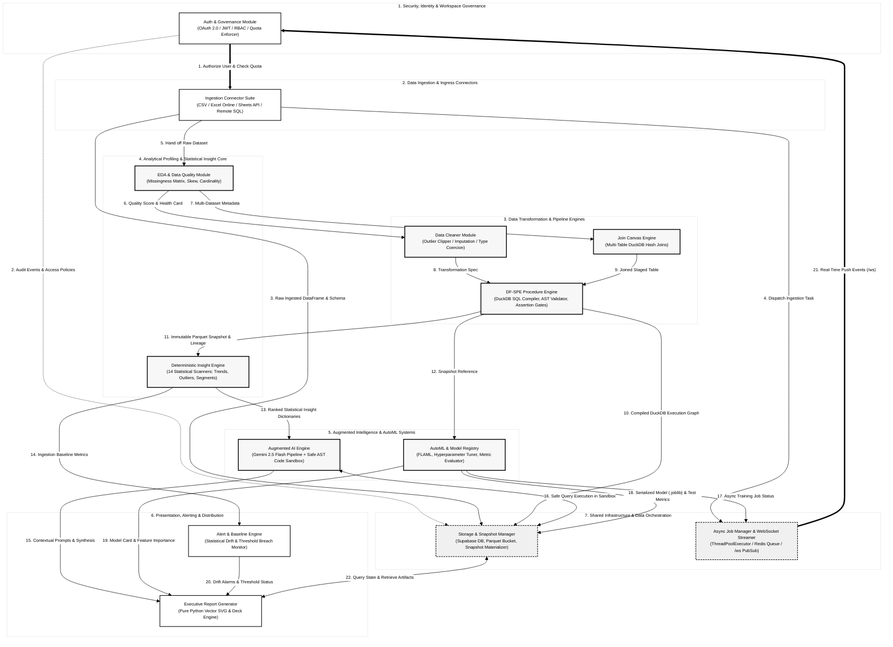

# Figure 3.5: Functional Module Interaction Diagram
**DataForge v3 System Architecture Series**  
**Document Standard:** Software Subsystem Interoperability & Component Collaboration  
**Page Budget:** 1 Page (A4 Portrait, Black & White / Grayscale Print-Ready)  

---

## 1. Architectural Narrative
Figure 3.5 models the functional dependencies, method contracts, and event streams interconnecting DataForge v3's core Python modules. Grouped into seven logical domains, these modules exhibit high cohesion and loose coupling:

1. **Security & Identity Governance (`M_AUTH`)**: Authenticates sessions via OAuth 2.0 / JWT and validates tenant usage limits before allowing ingestion.
2. **Ingress & Ingestion Suite (`M_INGEST`)**: Multi-source ingestion drivers (CSV, Excel Online, Google Sheets API, database connectors) parse files and hand raw DataFrames to the EDA profiler and storage.
3. **Data Transformation & Pipeline (`M_PIPELINE`)**: Composed of `M_CLEAN` (outlier clipping, median/mode imputation, type coercion), `M_JOIN` (DuckDB multi-table joins), and `M_DFSPE` (the SQL procedure compiler with AST expression validation and assertion gates).
4. **Analytical Profiling & Insights (`M_ANALYTICS`)**: `M_EDA` generates data quality health cards, while `M_INSIGHT` executes 14 statistical heuristics (trends, anomalies, correlations, segments) with mathematical rigor checks.
5. **Augmented AI & Machine Learning (`M_AI_ML`)**: `M_AI` connects to Google Gemini 2.5 Flash for narrative synthesis and safe sandboxed code execution; `M_AUTOML` trains predictive models via FLAML, logging metrics and artifacts to the registry.
6. **Presentation, Alerting & Distribution (`M_OUTPUT`)**: Pure Python vector SVG engine (`M_REPORT`) renders executive decks, while `M_ALERT` compares metrics against baselines to trigger alerts.
7. **Infrastructure & Orchestration (`M_INFRA`)**: `M_STORE` manages immutable snapshots and database transactions, while `M_JOBS` orchestrates the `ThreadPoolExecutor`, task queues, and `/ws` WebSocket streaming.

---

## 2. Mermaid Diagram

---

## 3. Inter-Module Contract Specifications

| Contract # | Caller Module | Callee Module | Protocol / Payload Description |
| :---: | :--- | :--- | :--- |
| **1** | `M_AUTH` | `M_INGEST` | `verify_quota(user_id, file_size)` → returns boolean admission |
| **3, 10** | `M_INGEST`, `M_DFSPE` | `M_STORE` | `save_parquet(upload_id, df)` → returns storage URI & hash |
| **4, 17** | `M_INGEST`, `M_AUTOML` | `M_JOBS` | `dispatch_job(func, *args)` → returns job UUID for polling / socket |
| **6, 7** | `M_EDA` | `M_CLEAN`, `M_JOIN` | Ingestion health dictionary with null counts, column types & unique counts |
| **8, 9** | `M_CLEAN`, `M_JOIN` | `M_DFSPE` | Procedural step nodes & join condition DAG for SQL compilation |
| **11, 12** | `M_DFSPE` | `M_INSIGHT`, `M_AUTOML` | Immutable Parquet snapshot path with verified tuple-level Why-Provenance |
| **13** | `M_INSIGHT` | `M_AI` | Ranked insight objects (type, score, p-value, metrics, narrative stub) |
| **14, 20** | `M_INSIGHT`, `M_ALERT` | `M_ALERT`, `M_REPORT` | Baseline metric snapshot; threshold check (`metric_drop`, `null_spike`) |
| **16** | `M_AI` | `M_STORE` | Safe Python execution in restricted AST sandbox against local snapshot |
| **18** | `M_AUTOML` | `M_STORE` | Model weights serialized via `joblib.dump()` + test evaluation metrics |
| **21** | `M_JOBS` | `M_AUTH` | Real-time WebSocket event broadcast: `{"event": "job_progress", ...}` |
